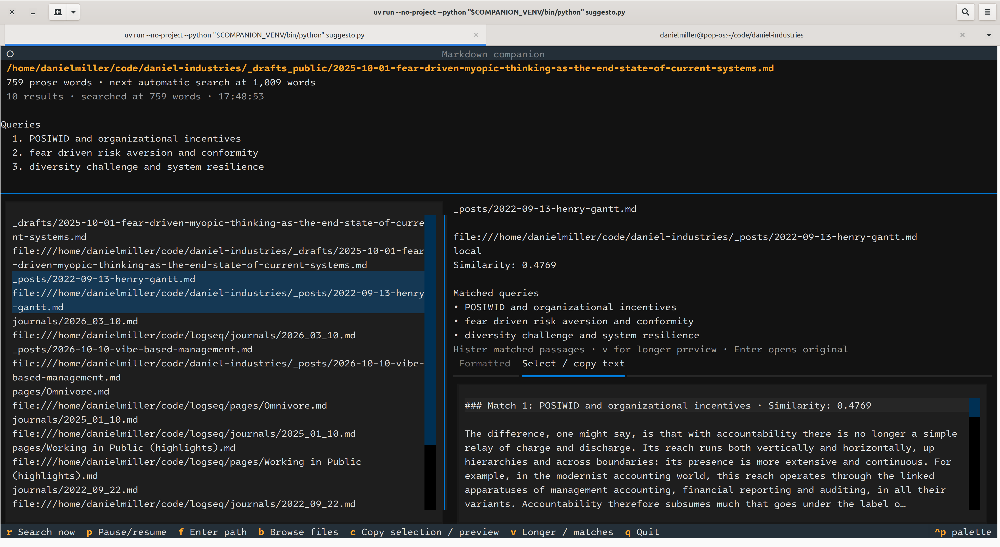

# Suggest-o-matic 2026

`suggesto.py` is a single-file Python 3.11+ terminal app. It watches a saved Markdown draft and suggests related material from an existing Hister index. See the [design plan](SUGGESTO_PLAN.md).



## Todos

- [ ] Summarize why each result is relevant to the draft.
- [ ] Support query generation with models other than OpenAI's.
- [ ] Generate search queries without a model.

## Hister setup

Follow Hister's [installation guide](https://hister.org/docs/installing) and [quickstart](https://hister.org/docs/quickstart) to run a server and index content. Enable [semantic search](https://hister.org/docs/configuration#semantic-search) and configure its embeddings endpoint.

## Starting with `uv`

Install [uv](https://docs.astral.sh/uv/), then run these commands from the directory containing `suggesto.py`. Choose an environment path; for example:

```sh
COMPANION_VENV=.venv-suggesto
# Or, to keep it outside this directory:
# COMPANION_VENV=../.venv-suggesto
uv venv --python 3.12 "$COMPANION_VENV"
uv pip install --python "$COMPANION_VENV/bin/python" textual openai httpx pyperclip python-dotenv
```

Set `COMPANION_VENV` again in each new shell. You can use Python 3.11 or newer; these commands request 3.12. No environment activation is needed.

Put your OpenAI API key in `.env` beside `suggesto.py`, or export it in your shell:

```dotenv
OPENAI_API_KEY='your-api-key'
```

Exported values take precedence over `.env`. The file is ignored by Git. If Hister requires a token, set `HISTER_ACCESS_TOKEN` the same way. With Hister running, launch the app with a Markdown file:

```sh
uv run --no-project --python "$COMPANION_VENV/bin/python" suggesto.py path/to/draft.md
```

Or omit the path to browse `.md` and `.markdown` files under `_drafts` and `_posts` beside the script:

```sh
uv run --no-project --python "$COMPANION_VENV/bin/python" suggesto.py
```

The picker shows drafts first, then posts, in reverse path order within each directory. Type words from a path or filename to filter; it shows at most 200 matches. Use Up/Down and Enter, or click a result. Escape exits if no file has been selected. Press `b` to reopen the picker or `f` to enter any existing Markdown path. Watching and API calls begin only after the first file is chosen.

Run `suggesto.py --help` with the same `uv run` prefix for all options. Useful overrides are `--word-step` (default 250), `--model` (default `gpt-6-luna`), `--limit` (1–50, default 10), `--hister-url` (default `http://127.0.0.1:4433/search`), and repeatable `--exclude-url`. A custom Hister endpoint must end in `/search`; a deployment path prefix is supported. The default model uses `reasoning.effort=none` and a 500-token output limit. Other models use their own reasoning defaults with the same output limit.

The app counts prose in the saved file, excluding front matter, fenced code, and common Markdown syntax and link destinations. This is lightweight cleanup, not a full Markdown parser. After two seconds without a change, it searches first at `--word-step` words and then after each net increase of that many words since the last successful search. A long draft starts with one search. Editing or deleting words alone does not start another automatic search; press `r` to search manually.

The watched file is excluded from results by local path and, when possible, its inferred Jekyll URL. URL matching ignores HTTP/HTTPS differences, trailing slashes, query strings, and fragments. Jekyll inference uses the nearest `_config.yml`, dated post filenames, and simple front matter fields. For custom permalinks or aliases it cannot infer, pass each URL with `--exclude-url`.

Select a result to see the matching passages Hister returned for each query, including similarity scores. If Hister supplies no matched chunk, the app labels the fallback as a search excerpt. Press `v` for a longer preview from a local Markdown file when available, or from Hister's `/api/document` endpoint. Passage previews are capped at 2,000 characters; longer previews show at most 20,000 characters and say when truncated. Enter opens the original result.

The preview is read-only and selectable. Press `c` to copy selected text, or the whole visible preview when nothing is selected. Ctrl+C copies a selection in the preview. Pyperclip handles the system clipboard, and the app verifies copied text by reading it back.

## Linux copy functionality

On Linux, Pyperclip needs a working clipboard helper and desktop display connection. For Debian or Ubuntu-based systems, install the helpers with:

```sh
sudo apt install xclip wl-clipboard
```

`pyperclip` is included in the `uv pip install` command above. If copying fails, run these checks in the terminal used to launch the app:

```sh
command -v xclip wl-copy wl-paste
printf 'Session=%s\nDISPLAY=%s\nWAYLAND_DISPLAY=%s\n' "$XDG_SESSION_TYPE" "$DISPLAY" "$WAYLAND_DISPLAY"
```

At least one display variable should be nonempty. A missing helper path points to an installation or `PATH` issue. The app shows the clipboard provider's first error line in its status area; include that message when troubleshooting. GNOME Terminal's Ctrl+Shift+C copies the terminal's own selection, while Ctrl+C in the app preview copies selected preview text.

## Keyboard shortcuts

| Key | Action |
| --- | --- |
| `r` | Search the saved draft after it settles, even below the threshold or while paused |
| `p` | Pause or resume automatic searches; an active search may finish |
| `f` | Enter another Markdown file path; Escape cancels |
| `b` | Browse `_drafts` and `_posts`; Escape cancels |
| Up/Down | Select a result and show its details |
| Enter | Open the selected result |
| Tab | Move focus between controls |
| `v` | Toggle matched passages and a longer preview |
| `c` | Copy selected text or the visible preview |
| Ctrl+A / Ctrl+C in the preview | Select all / copy selection |
| `q` | Quit |

OpenAI receives the draft title and cleaned prose to generate three queries. For drafts above 12,000 prose words, it receives the first and last 6,000 words. Requests set `store=False`. Before calling OpenAI, the app checks Hister's `/api/config` endpoint for availability, authentication, and enabled semantic search. It then searches Hister's `/search` endpoint once per query with semantic search enabled, merges results using reciprocal rank fusion, and excludes the watched post. The app does not change the draft or Hister's index.

Previous results stay visible during searches and errors. After a failed search, press `r` or add enough words to reach the next threshold. Switching files clears session results and ignores responses from the previous file. Restarting begins a new session.

---

## Technical walkthrough

### High-level structure

`suggesto.py` contains CLI validation, Markdown and URL helpers, a Hister client, OpenAI query generation, result merging, a file picker, and the Textual UI. The sections below follow that flow.

### 1. CLI argument parsing

`arguments()` accepts an optional Markdown path plus `--word-step`, `--model`, `--hister-url`, `--limit`, and repeatable `--exclude-url`. It validates Python 3.11+, the file when provided, a positive word step, a result limit of 1–50, and an HTTP(S) endpoint ending in `/search`. It loads `.env` beside the script without overriding exported values and requires `OPENAI_API_KEY`. Parsing precedes optional UI and API imports, so `--help` works without those packages.

### 2. Import guard

The import guard checks for `httpx`, `pyperclip`, `openai`, Rich, and Textual. `python-dotenv` is checked during argument parsing. The setup command above includes all required packages.

### 3. Core utilities and data

#### Markdown parsing helpers

`markdown_body()` removes top-of-file YAML front matter. `prose_and_title()` extracts a simple front matter title, skips fenced code and reference definitions, and removes common Markdown formatting and links before counting words. It does not fully parse Markdown.

#### URL and source helpers

`local_path()` resolves local file URLs and absolute paths. `url_key()` normalizes URLs for exclusions. `scalar()` reads simple Jekyll settings and front matter values. `source_index()` maps local posts to inferred published URLs and excludes the watched file and inferred URL; unsupported permalink placeholders require `--exclude-url`.

#### Snapshots and errors

`read_snapshot()` returns an immutable `Snapshot` with a SHA-256 digest, prose word count, title, query context, and trimming flag. It trims context above 12,000 words to the first and last 6,000. `CompanionError` and `error_message()` turn expected failures into short status messages without displaying request bodies.

### 4. Hister client

`HisterClient.check_available()` reads `/api/config` and rejects unavailable or disabled semantic search before any OpenAI request. `search()` calls `/search` with `q`, `semantic=true`, `format=json`, and a JSON-encoded `query` parameter containing the limit. It combines `history`, `documents`, and `semantic_hits`, keeping similarity and matched chunks when supplied. `document_text()` fetches indexed text from `/api/document` for longer previews.

### 5. OpenAI integration

`generate_queries()` sends the title and cleaned draft through the Responses API with a strict JSON schema for three queries. It sets `store=False` and `max_output_tokens=500`; only the default `gpt-6-luna` model gets `reasoning.effort=none`. The prompt treats draft text as data. The function removes punctuation that could act as Hister query operators and rejects empty or duplicate queries.

### 6. Result merging

`merge_results()` scores each query's results with reciprocal rank fusion (`1 / (60 + rank)`), gathers matched passages, filters excluded URLs, and returns up to `--limit` ranked hits. It keeps matches from multiple queries for a result. The client deduplicates records by exact URL within each query; the merger also keys hits by exact URL, while normalized URL keys are used for exclusions.

### 7. Textual UI

#### File picker and path dialog

`FilePicker` searches files under `_drafts` and `_posts` beside the script. `FileScreen` accepts any existing `.md` or `.markdown` path when switching files.

#### Preview and clipboard

`PreviewText` is a read-only selectable text area. `c` copies selected text or the visible preview; Ctrl+C copies a selection. Pyperclip supplies the system clipboard backend, and `copy_verified()` checks the clipboard contents after copying.

#### Companion app

##### Initialization and layout

`Companion` tracks the watched path, latest snapshot, last successful word-count baseline, search state, results, and preview cache. The left pane shows the file, counts, status, queries, and results; the right pane shows details and the preview.

##### Polling and search threshold

`poll()` reads the saved file once per second. `maybe_search()` waits two seconds after the last change, then starts a manual search or an automatic one when the word count reaches the baseline plus `--word-step`. It avoids retrying the same saved content automatically after a failure.

##### Search cycle

`search_cycle()` checks Hister, generates three queries, runs the three Hister searches in sequence, builds local URL mappings, and merges results. It updates the UI only for the current file. Errors leave previous results visible.

##### Preview loading and opening results

Matched passages appear on selection. A longer preview loads only when requested and is cached for the session. `open_hit()` opens HTTP(S) results in a browser and local files with the platform's file opener.

### Key design decisions

The UI uses asynchronous requests and background threads for file reads and clipboard operations. File digests and the settle timer avoid redundant searches during saves. Results survive request failures, while switching files clears state. The core flow is: poll → threshold check → query generation → Hister searches → merge → preview.
